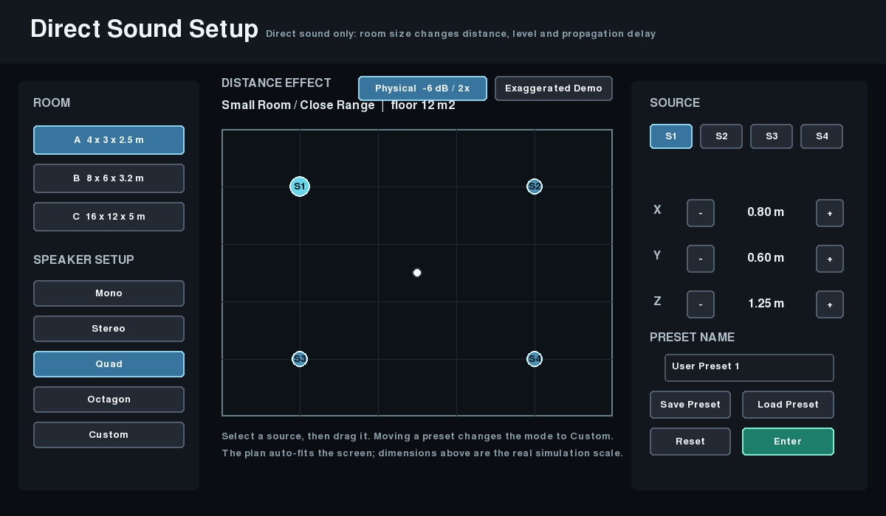

# Interactive Binaural Room

An interactive **direct-sound auralisation** built with Python, Pygame, OSC and REAPER. Place sound sources, move the listener and hear changes in direction, level and propagation delay through headphones.



## Features

- Mono, stereo, quad, octagon and custom layouts with 1–8 sources.
- Drag speakers or edit their X, Y and Z positions.
- Choose room dimensions and save/load layout presets.
- Move through the layout using a first-person listening view.
- Send source direction, listener yaw, gain and delay to REAPER over OSC.

This is the original direct-sound version: **no room scanning, reflections or reverberation calculations**. Room dimensions define the layout and distances.

## Setup

Requires Python, REAPER, **mcfx_gain_delay**, and the IEM **MultiEncoder**, **SceneRotator**, **EnergyVisualizer** and **BinauralDecoder** plug-ins.

1. In REAPER, open **Options → Show REAPER resource path**. Copy `REAPER_JSFX/TEZ_Smooth_Propagation_Delay.jsfx` into `Effects/TEZ/`.
2. Open the included `Project1.RPP`. Keep its source tracks and plug-in order unchanged.
3. Set REAPER's OSC control surface to receive on **8000** using the Default pattern. Enable MultiEncoder's OSC receiver on **8001** and SceneRotator's on **8002**.
4. Select headphones as the audio output.

Install Python dependencies from the repository root:

```sh
python3 -m venv .venv
.venv/bin/python -m pip install -r code/requirements.txt
```

Start the calculation engine in one terminal:

```sh
cd code
../.venv/bin/python main_interactive_listener.py
```

In a second terminal, from the repository root:

```sh
cd code
../.venv/bin/python fps_controller.py
```

On Windows, activate the environment and use `python` in place of the `.venv/bin/python` paths.

**Controls:** drag speakers in the setup view; use the XYZ buttons for position adjustments. **Space** switches between setup and listening view, **WASD** moves, the **mouse** changes direction, and **Esc** exits. Stop the engine with Ctrl+C.

## How it works

**Pygame GUI → OSC → Python direct-sound calculations → REAPER gain/delay → IEM Ambisonics → binaural headphone output**

The GUI sends listener/source positions to UDP **9000**. The engine calculates distance, azimuth, elevation, inverse-distance gain and time of flight. It returns source values to the GUI on **9001** and controls REAPER/IEM on ports **8000–8002**.

Each source uses **mcfx gain/generator → smooth propagation delay → mcfx residual gain**. The shared bus contains **MultiEncoder → SceneRotator → EnergyVisualizer → BinauralDecoder**.

Use **Physical Direct Sound** for the inverse-distance model: approximately −6.02 dB per distance doubling, clamped below 1 metre. **Exaggerated Demo** is a separate presentation effect. The REAPER gain range is −36…0 dB and the included delay effect spans 0–100 ms.

## Checks

From `code/`:

```sh
../.venv/bin/python test_room_math_once.py
../.venv/bin/python test_setup_state.py
../.venv/bin/python test_osc_mapping.py
../.venv/bin/python test_reaper_project.py
```

These cover direct-sound calculations, layout state, OSC mapping and REAPER project structure. They do not replace a live headphone playback check.
